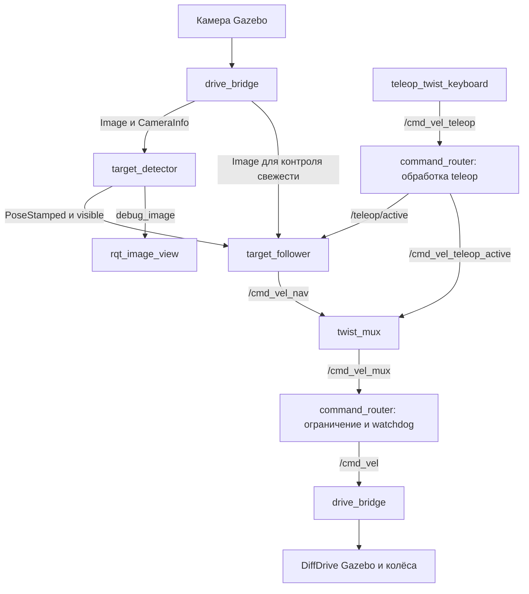

# Реализация движения Jetbot к маркеру ArUco

Документ описывает фактически реализованный пакет `jetbot_target_follower` для ДЗ 1 курса «Интеллектуальная робототехника 2026». Он объясняет устройство ROS-узлов, алгоритмы распознавания и управления, параметры и проведённые проверки. Состояние реализации — **5 октября 2026 года**.

Робот получает изображение, находит заданный ArUco-маркер, оценивает его положение относительно камеры и преобразует его в координаты корпуса. По расстоянию и направлению вычисляются скорости. Ручные команды проходят через `twist_mux` с повышенным приоритетом. При потере цели запускается поиск, при потере кадров автономное движение прекращается.

Реализация проверена в Gazebo Fortress с ROS 2 Humble. Управление на физическом Jetbot пока не проверялось. Команды эксплуатации также приведены в [CONTAINERS.md](../CONTAINERS.md).

## Состав реализации

Исходники находятся в [ros2_ws/src/jetbot_target_follower](../ros2_ws/src/jetbot_target_follower).

| Компонент | Что реализовано | Где находится |
|---|---|---|
| `target_detector` | ROS-узел приёма изображений, распознавания и публикации положения цели | [detector.py](../ros2_ws/src/jetbot_target_follower/jetbot_target_follower/detector.py) |
| `MarkerDetector` | Детекция ArUco и оценка положения по четырём углам; обычный Python-класс, не ROS-узел | [vision.py](../ros2_ws/src/jetbot_target_follower/jetbot_target_follower/vision.py) |
| `target_follower` | ROS-узел преобразования координат, контроля свежести и публикации автономных команд | [follower.py](../ros2_ws/src/jetbot_target_follower/jetbot_target_follower/follower.py) |
| `Follower`, `ControlConfig` | Регулятор и логика состояний без зависимости от ROS | [control.py](../ros2_ws/src/jetbot_target_follower/jetbot_target_follower/control.py) |
| `command_router` | ROS-узел обработки активности teleop, ограничения конечных скоростей и контроля команд mux | [router.py](../ros2_ws/src/jetbot_target_follower/jetbot_target_follower/router.py) |
| `twist_mux` | Готовый ROS-пакет выбора команд по приоритету и тайм-ауту | [twist_mux.yaml](../ros2_ws/src/jetbot_target_follower/config/twist_mux.yaml) |
| `drive_bridge` | Экземпляр готового `ros_gz_bridge/parameter_bridge` для связи ROS и Gazebo | [drive_sim.launch.py](../ros2_ws/src/jetbot_target_follower/launch/drive_sim.launch.py) |
| `teleop_twist_keyboard` | Стандартное клавиатурное управление, запускается отдельно | `make hw1-teleop` |
| `rqt_image_view` | Готовый просмотрщик отладочного изображения | `make hw1-view` |

Таким образом, собственных рабочих ROS-узлов три: `target_detector`, `target_follower` и `command_router`. Мост, mux, teleop и просмотрщик используются из существующих пакетов. Gazebo запускается отдельным процессом; его физика и система камеры не являются нашим Python-кодом.

## Поток данных



На схеме функции `command_router` и моста показаны отдельными блоками для читаемости. Каждая пара относится к одному соответствующему ROS-узлу.

Для движения используется обратная связь по изображению. Координаты Gazebo из `/simulation/poses` нужны только тестам: регулятор их не читает и не получает истинную позицию маркера из симулятора.

## Библиотеки и их роли

| Модуль | Использование |
|---|---|
| `rclpy` | ROS-узлы, подписки, публикации, параметры и таймеры |
| `sensor_msgs` | Изображение `Image` и калибровка `CameraInfo` |
| `cv_bridge.CvBridge` | Перевод `Image` в массив OpenCV и обратно |
| `cv2.aruco` | Словарь маркеров, поиск ID и четырёх углов |
| `cv2.solvePnP` | Оценка поворота и положения маркера |
| `cv2.projectPoints` | Проверка найденной позы по ошибке обратного проецирования |
| `cv2.polylines`, `drawFrameAxes`, `putText` | Рамка, оси и подпись на отладочном изображении |
| `numpy` | Массивы, матрицы преобразований, нормы векторов |
| `geometry_msgs` | Положение цели `PoseStamped` и скорости `Twist` |
| `std_msgs` | Признаки видимости/ручного режима, расстояния и строковое состояние |
| `rcl_interfaces` | Проверка изменений параметров и параметры только для чтения |
| `launch`, `launch_ros`, `ament_index_python` | Совместный запуск процессов и поиск установленных ресурсов пакета |
| `time.monotonic`, `ClockType.STEADY_TIME` | Контроль времени без зависимости от остановки часов симуляции |

В проверенном учебном образе установлен OpenCV **4.5.4** с модулем ArUco. Обработка изображения выполняется OpenCV на CPU; GPU используется Gazebo для рендеринга. Обучение модели, нейросеть, PyTorch и CUDA-детектор для этого решения не нужны.

## Подготовка мишени

Используется словарь `DICT_4X4_50`, ID `0`. Внутренний код состоит из 4×4 ячеек, а вместе с чёрной рамкой получается сетка 6×6. Сторона всего чёрного квадрата — **0,24 м**. Белое поле вокруг него — по 0,04 м, размер всей подложки — 0,32×0,32 м.

Параметр `marker_size` обозначает именно сторону чёрного квадрата с его рамкой, а не только внутренние 4×4 ячейки и не размер белой подложки.

[Генератор мишени](../ros2_ws/src/jetbot_target_follower/tools/generate_sim_assets.py) вызывает `cv2.aruco.drawMarker`, создаёт PNG и по полученным битам строит белую подложку с чёрными ячейками в SDF. В симуляторе используется эта геометрия: PNG не накладывается как текстура. Это позволяет явно задать размеры ячеек и их ориентацию.

Изображение для просмотра или печати: [marker_0.png](../ros2_ws/src/jetbot_target_follower/models/aruco_target/marker_0.png). Генератор также воспроизводит неподвижный мир; его запуск перезапишет ручные изменения этого мира. Подвижная модель и её настройки массы этим генератором не создаются.

## Распознавание изображения по шагам

### Приём изображения и калибровки

`TargetDetector.on_info()` получает матрицу камеры `K`, коэффициенты дисторсии `D` и разрешение из `/camera/camera_info`. Матрица имеет вид:

```text
K = [ fx   0  cx ]
    [  0  fy  cy ]
    [  0   0   1 ]
```

`fx`, `fy` задают фокусные расстояния в пикселях, `cx`, `cy` — положение главной точки. В текущей модели разрешение 848×480, `fx ≈ 615.9603`, `fy ≈ 616.2273`, `cx ≈ 419.8303`, `cy ≈ 245.1431`. Коэффициенты дисторсии симулятора равны нулю. Узел читает эти значения из сообщения, а не подставляет их константами из этого документа.

Узел принимает модели дисторсии `plumb_bob`, `rational_polynomial` и пустое имя. Проверяются конечность чисел, положительные `fx` и `fy`, совпадение размеров CameraInfo и изображения. При отсутствии подходящей калибровки публикуется `visible=false`, оценка положения не вычисляется.

`on_image()` преобразует ROS-сообщение в BGR-массив:

```python
frame = self.bridge.imgmsg_to_cv2(msg, desired_encoding='bgr8')
```

### Выделение маркера

В `MarkerDetector.detect()` изображение переводится в оттенки серого через `cv2.cvtColor`. В OpenCV 4.5.4 вызывается `cv2.aruco.detectMarkers`. Предусмотрена ветка с `cv2.aruco.ArucoDetector` для версий, в которых доступен этот класс; отдельно такая версия контейнера не проверялась.

Внутри стандартного детектора OpenCV выполняются поиск кандидатов по пороговому изображению и контурам, отбор четырёхугольников, перспективное выпрямление кандидата и чтение его бинарных ячеек. Код сверяется со словарём с учётом ориентации и допустимых ошибок. Эти этапы реализованы библиотекой, а не написаны вручную в проекте. [Алгоритм ArUco в OpenCV](https://docs.opencv.org/4.5.4/d5/dae/tutorial_aruco_detection.html).

В нашем коде дополнительно включено субпиксельное уточнение углов:

```python
self.parameters.cornerRefinementMethod = cv2.aruco.CORNER_REFINE_SUBPIX
```

Затем оставляется только `marker_id=0`. Если один ID обнаружен несколько раз, выбирается кандидат с наибольшей площадью по `cv2.contourArea`. Изображения с другими ID не считаются целью. Результат этапа — четыре двумерных угла нужного маркера.

### Вычисление положения через PnP

Для известного размера `L` задаются четыре угла в системе самого маркера:

```text
(-L/2, +L/2, 0)
(+L/2, +L/2, 0)
(+L/2, -L/2, 0)
(-L/2, -L/2, 0)
```

Им соответствуют четыре найденные точки изображения. Код передаёт эти пары, `K` и `D` в:

```python
cv2.solvePnP(
    object_points, image_points, matrix, distortion,
    flags=cv2.SOLVEPNP_ITERATIVE,
)
```

PnP — задача определения положения объекта по известным пространственным точкам и их проекциям. Выбранный итеративный метод использует оптимизацию Левенберга — Марквардта; для плоских точек начальное приближение получается через гомографию. [Описание solvePnP](https://docs.opencv.org/4.13.0/d5/d1f/calib3d_solvePnP.html).

Возвращаются `rvec` и `tvec`. В нашем соглашении они задают преобразование из системы маркера в систему камеры:

```text
point_camera = R(rvec) × point_marker + tvec
```

Начало системы маркера находится в его центре, поэтому `tvec` — координаты центра относительно камеры. Если `L` задан в метрах, компоненты `tvec` также получаются в метрах. Ошибка физического размера маркера непосредственно искажает масштаб оценки расстояния.

В реализации используется `SOLVEPNP_ITERATIVE`, без `solvePnPRansac`, IPPE, фильтра Калмана или накопления измерений между кадрами. Каждый кадр обрабатывается независимо.

### Проверка результата

Решение отбрасывается, если PnP завершился неуспешно, координаты содержат нечисловые значения или глубина `tvec.z` неположительна.

Далее `cv2.projectPoints` проецирует пространственные углы обратно в изображение. Вычисляется:

```text
reprojection_error = sqrt(mean(||projected_corner − detected_corner||²))
```

Это среднеквадратичная ошибка по четырём двумерным углам в пикселях. При значении больше **3 пикселей** детектор публикует `visible=false` и не публикует новую позу. Маленькая ошибка проекции не является гарантией точного расстояния при неверной калибровке или неверном размере маркера.

### Публикация результата

При успешном обнаружении публикуются:

- `/target/pose`: положение и ориентация центра маркера;
- `/target/distance`: длина `tvec`, то есть расстояние от камеры до центра;
- `/target/visible`: `true`;
- `/target/debug_image`: кадр с рамкой, осями и числовой подписью.

`rvec` преобразуется в кватернион функцией `quaternion_from_rvec()` через представление «ось — угол». Для нулевого угла используется единичный кватернион.

Время `/target/pose` берётся из исходного кадра. `frame_id` задаётся как `camera_optical_frame`: PnP использует оптические оси. Изменение строки frame_id само по себе не создаёт TF-преобразование. В этом пакете преобразование до корпуса выполняется численно в регуляторе.

Когда маркер не найден, публикуется `visible=false`, но старые числовые значения расстояния не заменяются нулём. Поэтому потребитель обязан проверять видимость и свежесть позы, а не использовать последнее число бессрочно.

## Системы координат и расстояния

Оптическая система камеры:

```text
x — вправо по изображению
y — вниз по изображению
z — вперёд вдоль оптической оси
```

Система управления корпусом:

```text
x — вперёд по роботу
y — влево
z — вверх
```

В `TargetFollower.on_pose()` выполняется:

```text
p_body = R_camera_to_body × p_camera + t_camera_to_body
```

Для подвижного опыта заданы `camera_translation=[0.06, 0, 0.14]` м и `camera_rotation_rpy=[−π/2, 0, −π/2]`. Функция `rotation_rpy` собирает матрицу как `Rz(yaw) × Ry(pitch) × Rx(roll)`. С текущими параметрами преобразование можно записать так:

```text
x_body =  z_camera + 0.06
y_body = −x_camera
z_body = −y_camera + 0.14
```

После преобразования используются:

```text
d_body = sqrt(x_body² + y_body²)
angle  = atan2(y_body, x_body)
```

**`stop_distance` относится к расстоянию в плоскости корпуса от его начала координат до цели.** Это не зазор от переднего края корпуса до стены. `/target/distance` показывает другое расстояние — трёхмерное, от камеры. Поэтому подпись `range` на изображении возле точки остановки будет меньше 0,5 м.

Параметры преобразования соответствуют подвижному опыту. Неподвижный опыт использует исходную ориентацию камеры и запускает только распознавание. Подключать к нему регулятор с параметрами подвижного опыта без согласования камеры нельзя.

## Управление скоростями

`TargetFollower` работает таймером с периодом 0,05 с, то есть **20 Гц реального времени**. Он передаёт последние пригодные измерения в независимый от ROS класс `Follower`. Камера подвижного опыта настроена на 15 Гц симуляционного времени; фактическая частота зависит от скорости работы Gazebo.

Сейчас реализованы **два P-регулятора** — по расстоянию и направлению. Интегральной и дифференциальной составляющих нет, поэтому называть текущий регулятор PID некорректно.

```text
error_distance = d_body − stop_distance
v_raw = kp_distance × error_distance
w_raw = kp_angle × angle
```

Затем применяются ограничения:

```text
v_limited = clamp(v_raw, −min(0.06, max_linear_speed), max_linear_speed)
w_limited = clamp(w_raw, −max_angular_speed, max_angular_speed)
v_desired = v_limited × max(0, cos(angle))
```

При большой угловой ошибке, более **0,4 рад** (примерно 23°), линейная скорость принудительно обнуляется: робот сначала разворачивается. Если он оказался слишком близко, допускается движение назад не быстрее 0,06 м/с.

В режимах подхода и выравнивания изменение скорости ограничивается:

```text
new_speed = old_speed + clamp(desired_speed − old_speed, −acceleration × dt, +acceleration × dt)
```

Для этого `dt` ограничивается диапазоном 0,001–0,1 с. Ускорения по умолчанию — 0,25 м/с² и 1,5 рад/с². Остановки при потере кадров, ручном управлении и достижении цели выполняются сразу; ограничение нарастания скорости к ним не применяется. В поиске угловая скорость также задаётся непосредственно.

### Остановка и гистерезис

При `abs(error_distance) ≤ 0.02 м` устанавливается `ARRIVED`, обе команды обнуляются. Выход из этого состояния происходит, когда абсолютная ошибка превышает `0.02 + 0.04 = 0.06 м`. Разные пороги входа и выхода предотвращают частые переключения из-за шума.

Достижение дистанции не требует заданной конечной ориентации робота. После ручного вмешательства или потери цели признак прибытия сбрасывается, поэтому робот может снова подойти к маркеру.

## Состояния и восстановление

| Состояние | Условие | Команда автономного узла |
|---|---|---|
| `DISABLED` | `enabled=false` | Ноль |
| `MANUAL` | Активен teleop | Ноль; конечное управление получает teleop через mux |
| `NO_IMAGE` | Нет свежих кадров или сообщений видимости от детектора | Ноль |
| `LOST` | Свежие данные поступают, но пригодной цели нет; задержка поиска ещё не истекла | Ноль |
| `SEARCH` | Цель потеряна достаточно давно | Линейная скорость 0, медленный поворот |
| `ALIGN` | Цель найдена, но направление отличается более чем на 0,4 рад | Только поворот |
| `APPROACH` | Цель найдена и достаточно близка к направлению вперёд | Подход или небольшой отход с коррекцией курса |
| `ARRIVED` | Дистанция в пределах допуска | Ноль |

Поиск начинается через 0,6 с с последнего принятого положения цели, а не строго с первого кадра без маркера. Скорость поиска — 0,25 рад/с, дополнительно ограниченная `max_angular_speed`.

Направление поворота запоминается по последнему углу цели, если его модуль больше 0,03 рад. Оно обновляется и во время ручного управления, пока цель ещё видна. До первого наблюдения используется положительное направление поворота. Лидар для поиска не используется; обход препятствий не реализован.

Признак `visible=false` объединяет несколько причин: маркер отсутствует, калибровка непригодна или решение PnP отклонено. При свежем изображении эта ситуация приводит к ожиданию/поиску. Отдельного состояния ошибки калибровки в регуляторе пока нет.

## Teleop и выбор источника команд

`make hw1-teleop` запускает стандартный `teleop_twist_keyboard` с переназначением выходного топика в `/cmd_vel_teleop`. Заданы скорость 0,12 м/с, поворот 0,5 рад/с, повтор 10 Гц и `key_timeout=0.3 с`.

`CommandRouter.teleop()` ограничивает разрешённые компоненты `linear.x` и `angular.z`. Остальные компоненты Twist в выходе остаются нулевыми. Для нечисловых значений этих двух компонент формируется нулевая команда. Команда считается активной, когда сумма модулей линейной и угловой компонент превышает `1e-6`.

При активной команде router публикует её в `/cmd_vel_teleop_active` и сообщает `/teleop/active=true`. При переходе к нулю один нулевой Twist передаётся в приоритетный вход, затем повторные нули отфильтровываются.

Это дополнение нужно потому, что обычный `twist_mux` учитывает приоритет и свежесть входа, а не смысл нулевой скорости. Постоянный поток нулей способен удерживать высокий приоритет. [Реализация обработчика входов twist_mux Humble](https://raw.githubusercontent.com/ros-teleop/twist_mux/humble/include/twist_mux/topic_handle.hpp).

| Вход mux | Приоритет | Тайм-аут |
|---|---:|---:|
| `/cmd_vel_nav` | 10 | 0,30 с |
| `/cmd_vel_teleop_active` | 100 | 0,15 с |

После единственного нуля управление возвращается автономному узлу по истечении тайм-аута ручного входа и на следующей подходящей публикации. Переключение не мгновенное: это примерно 0,15 с симуляционного времени плюс ожидание следующего цикла/доставки сообщения. Если `twist_mux` получает часы Gazebo, задержка в реальных секундах зависит от темпа симуляции.

Выход mux `/cmd_vel_mux` возвращается в `command_router`, который повторно ограничивает скорости и публикует окончательный `/cmd_vel`. Этот топик мост передаёт системе DiffDrive Gazebo. Router не подменяет собой mux: выбор приоритета выполняется в `twist_mux`.

**`k` в teleop означает освобождение ручного управления для автономного режима.** Для отключения автономного режима используется `enabled=false`; ручные команды при этом всё ещё разрешены.

## Контроль свежести и завершение

| Проверка | Значение | Где выполняется |
|---|---:|---|
| Нет успешной детекции | 1,0 с | Детектор публикует `visible=false`; проверка каждые 0,2 с |
| Возраст принятой позы | 0,5 с | Регулятор исключает её из управления |
| Нет свежего изображения | 0,8 с | Регулятор обнуляет автономную команду |
| Нет сообщений `/target/visible` | 0,8 с | Регулятор обнуляет автономную команду |
| Нет ненулевых сообщений teleop | 0,4 с | Router освобождает ручной режим |
| Нет сообщений от mux | 0,3 с | Router публикует ноль в `/cmd_vel` |

Регулятор сначала проверяет timestamp кадра/позы относительно ROS-времени; допускается расхождение в будущее не больше 0,1 с. Отдельно возраст с момента получения измеряется монотонными часами. Это позволяет остановиться при паузе Gazebo, когда ROS-время перестало двигаться.

Публикация bool видимости не является полноценным сообщением диагностики с указанием причины ошибки. Поза содержит время кадра; скалярные расстояния и bool собственного timestamp не имеют.

В `drive_sim.launch.py` завершение Gazebo или любого обязательного ROS-процесса вызывает остановку launch. Watchdog router полезен, пока сам router работает. Для переноса на физический робот нужен также тайм-аут команд в драйвере моторов, независимый от Python-процессов.

## Полная карта топиков

| Топик ROS | Тип | Производитель → потребитель |
|---|---|---|
| `/camera/image/raw` | `sensor_msgs/msg/Image` | Мост → детектор и регулятор |
| `/camera/camera_info` | `sensor_msgs/msg/CameraInfo` | Мост → детектор |
| `/target/pose` | `geometry_msgs/msg/PoseStamped` | Детектор → регулятор |
| `/target/distance` | `std_msgs/msg/Float64` | Детектор → диагностика |
| `/target/visible` | `std_msgs/msg/Bool` | Детектор → регулятор |
| `/target/debug_image` | `sensor_msgs/msg/Image` | Детектор → просмотрщик |
| `/target/base_distance` | `std_msgs/msg/Float64` | Регулятор → диагностика |
| `/follower/state` | `std_msgs/msg/String` | Регулятор → диагностика и тесты |
| `/cmd_vel_nav` | `geometry_msgs/msg/Twist` | Регулятор → mux |
| `/cmd_vel_teleop` | `geometry_msgs/msg/Twist` | Teleop → router |
| `/cmd_vel_teleop_active` | `geometry_msgs/msg/Twist` | Router → mux |
| `/teleop/active` | `std_msgs/msg/Bool` | Router → регулятор |
| `/cmd_vel_mux` | `geometry_msgs/msg/Twist` | Mux → router |
| `/cmd_vel` | `geometry_msgs/msg/Twist` | Router → мост → DiffDrive |
| `/clock` | `rosgraph_msgs/msg/Clock` | Gazebo через мост → узлы с `use_sim_time=true` |
| `/simulation/poses` | `tf2_msgs/msg/TFMessage` | Gazebo через мост → интеграционный тест |

Подписки на изображения и CameraInfo используют `qos_profile_sensor_data`; обычные публикации детектора и команд создаются с глубиной очереди 1. Это не синхронизатор кадров и CameraInfo: применяется последняя пригодная калибровка с совпадающим разрешением.

## Параметры и файлы запуска

Конфигурация распознавания: [detector.yaml](../ros2_ws/src/jetbot_target_follower/config/detector.yaml). Конфигурация регулятора и router: [follower.yaml](../ros2_ws/src/jetbot_target_follower/config/follower.yaml).

| Параметр | По умолчанию | Назначение |
|---|---:|---|
| `marker_size` | 0,24 м | Сторона чёрного квадрата |
| `marker_id` | 0 | Нужный маркер |
| `stop_distance` | 0,50 м | Дистанция остановки от системы корпуса |
| `max_linear_speed` | 0,15 м/с | Максимум автономной линейной скорости |
| `max_angular_speed` | 0,65 рад/с | Максимум автономного поворота |
| `kp_distance` | 0,65 | Усиление ошибки расстояния |
| `kp_angle` | 1,8 | Усиление ошибки направления |
| `distance_tolerance` | 0,02 м | Вход в состояние остановки |
| `arrival_hysteresis` | 0,04 м | Добавка к порогу выхода из остановки |
| `turn_in_place_angle` | 0,4 рад | Порог поворота без движения вперёд |
| `linear_acceleration` | 0,25 м/с² | Ограничение изменения линейной скорости |
| `angular_acceleration` | 1,5 рад/с² | Ограничение изменения угловой скорости |
| `search_speed` | 0,25 рад/с | Скорость поиска |
| `enabled` | true | Включение автономного управления |

У router есть собственные `max_linear_speed=0.15` и `max_angular_speed=0.65` — общий предел для обоих источников. Увеличение только предела регулятора не увеличит конечную команду выше ограничения router.

Параметры детектора задаются при запуске и объявлены только для чтения. При изменении размера/ID или других параметров детектора требуется перезапуск. Регулятор читает свои параметры в ходе работы и проверяет изменения через callback ROS-параметров. Практический пример:

```bash
# В контейнере ноутбука
export ROS_DOMAIN_ID=45 ROS_LOCALHOST_ONLY=1
ros2 param set /target_follower enabled false
ros2 param set /target_follower stop_distance 0.6
ros2 param set /target_follower enabled true
```

`make hw1` запускает неподвижный опыт из [perception_sim.launch.py](../ros2_ws/src/jetbot_target_follower/launch/perception_sim.launch.py). `make hw1-drive` запускает подвижный опыт из [drive_sim.launch.py](../ros2_ws/src/jetbot_target_follower/launch/drive_sim.launch.py). Оба выполняют сборку пакета через colcon перед запуском.

Drive-launch поддерживает `gui`, `enabled`, `x`, `y`, `yaw` и `stop_distance`. При отсутствии аргумента `stop_distance` значение берётся из YAML. Начальное положение записывается во временную копию SDF мира. Launch задаёт `ROS_DOMAIN_ID=45`, `ROS_LOCALHOST_ONLY=1`, `IGN_PARTITION=robo_hw1` и путь моделей. Одновременный запуск двух опытов в этом домене не предусмотрен.

## Модели и физика

| Опыт | Модель | Особенности |
|---|---|---|
| Неподвижное распознавание | `jetbot_hw1` | Копия исходной модели; закреплена, камера сохраняет исходный наклон |
| Движение к цели | `jetbot_hw1_drive` | Подвижная копия, масса 1,5 кг, камера направлена вперёд |

Для подвижной модели сначала исправлена масса корпуса исходника со 100 кг, затем массы и инерции всех звеньев пропорционально приведены к суммарным 1,5 кг. Получились приблизительно: корпус 0,6195 кг, опорный шарик 0,0074 кг, камера 0,0427 кг, лидар 0,3496 кг и по 0,2404 кг на колесо. Эти значения — расчётное распределение, а не результаты взвешивания отдельных деталей.

Снижены сопротивление вращению колёс и трение опорного шарика. Камера работает с исходными разрешением и внутренними параметрами, но имеет новое положение и ориентацию. Система Gazebo `DiffDrive` получает скорости из `/model/jetbot/cmd_vel`; в модели заданы радиус колёс 0,033 м и база колёс 0,15 м. Встроенные колёсные команды исполняет симулятор, Python-регулятор не рассчитывает токи моторов.

Лидар остаётся частью модели, но не включён в алгоритм подхода. Мир содержит плоский пол и мишень. Исходный склад и его модель Jetbot не изменены.

## Как запускать и наблюдать

На хосте ноутбука:

```bash
cd /data/WORK/study/robo
make up
make hw1-drive
```

В отдельных терминалах той же папки:

```bash
make hw1-view
```

```bash
make hw1-teleop
```

Для диагностики:

```bash
make shell
export ROS_DOMAIN_ID=45 ROS_LOCALHOST_ONLY=1
ros2 topic echo /follower/state
```

В других терминалах контейнера с теми же переменными:

```bash
ros2 topic echo /target/base_distance --once
ros2 topic echo /cmd_vel --once
ros2 topic hz /target/debug_image
```

Прямой запуск после сборки пакета, например с боковым смещением:

```bash
ros2 launch jetbot_target_follower drive_sim.launch.py y:=-0.25 yaw:=0.15 stop_distance:=0.5
```

`yaw` задаётся в радианах. Перед новым запуском остановите предыдущий. Закрытие окна Gazebo завершает drive-launch; при запуске из терминала также можно использовать Ctrl+C.

## Проверки и результаты

[Тесты распознавания](../ros2_ws/src/jetbot_target_follower/test/test_vision.py) создают синтетические изображения с известными проекциями маркера. Проверяются расстояние и боковое смещение, отклонение чужого ID, отсутствие/перекрытие маркера, недопустимые параметры и преобразование ориентации.

[Тесты регулятора](../ros2_ws/src/jetbot_target_follower/test/test_control.py) проверяют ограничения скорости, поворот до движения, гистерезис остановки, поиск, остановку при потере кадров, ручной режим, отключение, движение назад, параметры и общую массу модели. Всего прошло **13 тестовых методов**.

```bash
# В контейнере
python3 -m unittest discover -s /work/ros2_ws/src/jetbot_target_follower/test -v
```

[Интеграционный тест](../ros2_ws/src/jetbot_target_follower/test/test_drive_gazebo.py) работает с настоящим рендерингом и физикой Gazebo. Перед каждым заездом отключает автономное управление, переставляет модель, даёт ей стабилизироваться и снова включает регулятор. Критерий остановки проверяет независимо от камеры по координатам робота и известной позиции мишени.

Результаты при `stop_distance=0.5 м`:

| Старт x, y, yaw | Фактическая дистанция остановки |
|---|---:|
| 0, 0, 0 | 0,5253 м |
| 0, −0,25, 0,15 | 0,5249 м |
| 0, 0,25, −0,15 | 0,5245 м |
| 0,25, −0,15, 0 | 0,5252 м |
| 0,2, 0,2, −0,25 | 0,5247 м |

**5 из 5 попыток** попали в заданный интервал (0,375; 0,625) м. Это результаты выбранных стартов в текущей сцене, а не статистическая оценка надёжности на произвольных сценах.

Дополнительно проверены:

- непрерывная отправка нулей teleop — автономное движение не блокируется;
- ручной поворот со скоростью 0,5 рад/с в течение 2,8 с до потери цели, затем освобождение управления — остановка в 0,5255 м;
- перекрытие изображения виртуальной заслонкой на 2 с, затем удаление заслонки — остановка в 0,5257 м;
- пауза Gazebo — `NO_IMAGE` и нулевая команда; после снятия паузы остановка в 0,5250 м.

Заслонка в тесте — визуальная геометрия для проверки потери маркера, без collision. Этот сценарий не проверяет объезд физического препятствия.

Для повторения интеграционных проверок при работающем подвижном опыте:

```bash
# В другом терминале контейнера
export ROS_DOMAIN_ID=45 ROS_LOCALHOST_ONLY=1 IGN_PARTITION=robo_hw1
python3 /work/ros2_ws/src/jetbot_target_follower/test/test_drive_gazebo.py
```

Тест перемещает виртуальные объекты и в конце выключает автономное управление. Результаты пишутся в `.runtime/hw1-drive-tests.json`; файл локальный и исключён из Git. Критерии этого теста фиксированы для мишени текущего мира и stop_distance=0.5 м: после изменения сцены или дистанции нужно согласованно обновить тест.

## Что потребуется для переноса на Jetbot

Логика распознавания и регулятор отделены от Gazebo. Для переноса потребуется подготовить отдельный launch реального робота, подать изображение и CameraInfo, измерить преобразование камеры в систему корпуса и подключить выход mux/router к фактическому входу драйвера моторов.

Понадобятся калибровка камеры под выбранный режим, проверка фактического размера печатного маркера, настройка скоростей и коэффициентов на реальном покрытии. Код использует P-регуляторы и простую логику поиска: глобальная навигация, обход препятствий и полноценное состояние ошибки калибровки не реализованы. Истинные координаты симулятора в управление не входят, но успешные симуляционные заезды не заменяют проверки физического робота.

## Как читать исходники

Начните с `vision.py`: он показывает, откуда берётся положение маркера. Затем прочитайте `detector.py` для связи алгоритма с ROS. После этого `control.py` объяснит поведение робота без деталей сообщений, а `follower.py` — преобразование координат, время и публикацию команд. `router.py`, `twist_mux.yaml` и `drive_sim.launch.py` завершают картину ручного перехвата и запуска всего приложения.
